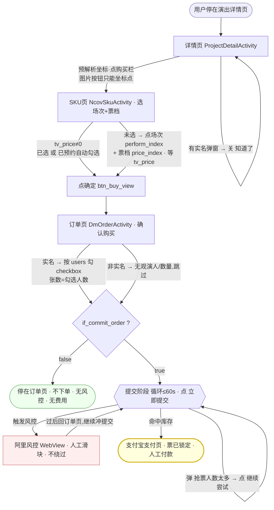

# 大麦抢票 —— 流程与状态机

> 单一真相源。改代码/对选择器前先读。图例:✅实测 ◆判断 ⬛人工。
> **测试基线:大麦 App v9.0.37 / 真机华为 TEL-AN10 Android 10 / 2026-10-29**。App 改版后对照更新并改此版本号。

## 状态机(一图胜千言)

**锁票定义**:到达 **支付宝支付页 = 票已锁定**(大麦已生成待支付订单,占库存、有倒计时,放弃自动释放)。"立即提交"只是尝试,可能被风控/缺货退回,不算锁。
**两个人工点**:① 提交后风控滑块 ② 支付宝付款;其余全自动。

## 选择器速查

| 状态 | Activity | 关键控件 |
|---|---|---|
| 详情页 | ProjectDetailActivity | 购买栏 `trade_project_detail_purchase_status_bar_container_fl`(图片无文字);倒计时 `id_new_project_normal_count_down_layout`;实名弹窗关闭键 `damai_theme_dialog_cancel_btn` |
| SKU页 | NcovSkuActivity | 场次 `ll_perform_item`;票档容器 `project_detail_perform_price_flowlayout`(票档=内部FrameLayout,价格文字空→靠 price_index);已选判据 `tv_price`≠0;确定 `btn_buy_view` |
| 订单页 | DmOrderActivity | "立即提交"(文字可读);实名观演人行 `layout_main`/`text_name`/`checkbox`(点checkbox,张数=人数);非实名无观演人/数量 |
| 风控 | ...fc.ui.ContainerActivity | WebView人机校验,不绕过 |
| 支付 | com.eg.android.AlipayGphone | 待支付订单=锁票 |

## 关键事实

- **两条路在SKU/订单页汇合**:已预约=大麦开抢自动勾选票档、观演人在H5预选好→脚本仅"确定→提交";未预约=脚本现场选。
- **观演人/票档预约在 H5**(DMH5Activity)由用户手动就绪,脚本不碰。
- **重试=提交阶段重发动作**(点"立即提交"/"继续尝试"冲库存),**不是重连**。
- **预售**演出提交不即时锁票(一直"继续尝试");清晰在售才跳支付宝。**缺货**场次点确定走"缺货登记",非下单。
- **状态最可靠来源=搜索结果 `tv_project_status`**(热卖中/缺货登记),非详情页图片按钮。
- **时延**:实测详情页→风控 3.27s,主要是 app 页面转场+旧华为渲染,我方代码开销极低。

## 待补(次要)
可选座选座页;预约制/售罄详情态判据;开抢瞬间"已预约自动勾选"落点活测(需真实开抢)。
